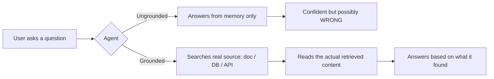

# Topic 1: What is Grounding?

> **Workshop:** Agentic AI for QA — Day [X]
> **Session:** Grounded QA Agents (Theory before Build)

---

## 1. The One-Line Definition

> **Grounding** means forcing an AI agent to base its answer on a **specific, real, verifiable source of information** — instead of letting it answer purely from what it "remembers" from training.

In simple words: **"Don't guess. Go check the document first, then answer."**

---

## 2. An Everyday Analogy (No Tech Needed)

Think of two colleagues answering a QA process question:

| | **Colleague A (Ungrounded)** | **Colleague B (Grounded)** |
|---|---|---|
| You ask | "What's our SLA for a Critical bug?" | "What's our SLA for a Critical bug?" |
| What they do | Answers immediately from memory/gut feel, confident-sounding | Opens the QA Standards doc, finds Section 1, reads it, then answers |
| Risk | They might be *wrong*, *outdated*, or just making it sound plausible | Answer is backed by an actual document you can go verify |

Both colleagues can *sound* equally confident. The difference is **where the answer came from.**

An AI agent behaves exactly like Colleague A by default. Grounding is what turns it into Colleague B.

---

## 3. Why This Matters for AI Specifically

LLMs (the AI models behind our agents, e.g. Gemini, GPT) are trained once on a huge amount of general internet text. They do **not** automatically know:

- Your company's severity definitions
- Your test environment names (`qa-blue`, `qa-green`, `staging`)
- Your exact API field names and status codes
- Your test case naming convention (`TC-<JIRA-KEY>-<seq>`)

If you ask an LLM a company-specific question with no grounding, it does one of two things:

1. **Honestly says "I don't know"** (rare, and often not even accurate about *why* it doesn't know), or
2. **"Fills the gap" with a plausible-sounding but invented answer** — this is called **hallucination**, and it's the single biggest trust problem with AI agents.

Grounding is the fix: we give the agent a way to **look something up** before it answers, instead of relying only on what it already "knows."

---

## 4. The Core Idea in One Picture

The destination (an answer) looks the same either way. **What's different is the path the agent took to get there** — and that path is exactly what we can inspect, trust, and verify.

---

## 5. Grounding ≠ Just "Giving the AI a Document"

A common misunderstanding: grounding is not simply pasting a PDF into a prompt once.

Grounding properly means the agent:

1. **Has access to a trusted knowledge source** (a document, database, API, ticketing system, etc.)
2. **Is instructed/forced to consult that source** for relevant questions (not optional — this is a *rule*, not a *suggestion*)
3. **Builds its answer from what it retrieved**, not from general training knowledge
4. **Can say "I don't know / not documented"** when the source has no answer — instead of inventing one

If any of these 4 pieces is missing, the agent is not truly grounded — even if it technically "has" a document somewhere nearby.

---

## 6. Quick Self-Check (Think About It)

- When you, as a manual QA tester, are asked "What's the regression suite policy?" — do you answer from memory, or do you check the QA Standards doc?
- If an AI agent is going to answer that same question *on your behalf* to a developer or PM, should it be allowed to just "remember" an answer? Or should it be **required** to check the same document you would check?

> That requirement — *"check the real source before answering"* — is grounding. Everything else we discuss today (RAG, embeddings, vector search) is simply **how we technically make that checking possible** inside an n8n agent.