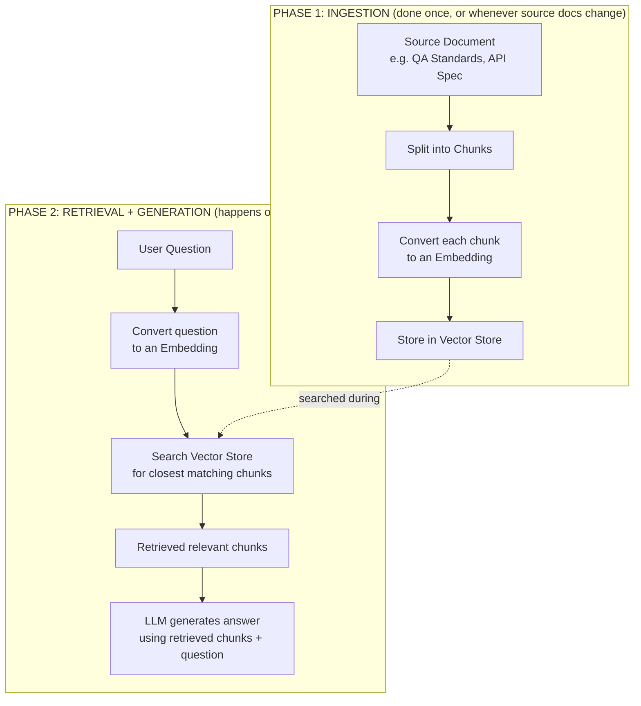

# Topic 3: What is RAG (Retrieval-Augmented Generation)?

> **Workshop:** Agentic AI for QA — Day [X]
> **Session:** Grounded QA Agents (Theory before Build)

---

## 1. The One-Line Definition

> **RAG = Retrieval-Augmented Generation.** Before the AI *generates* an answer, it first *retrieves* relevant real information, and uses that retrieved content to *augment* (enrich) its answer.

In short: **Retrieve → Augment → Generate.**

RAG is the actual **technique** we use to achieve grounding (Topics 1 & 2 explained *why* we need it — this topic explains *how* it technically works).

---

## 2. Breaking Down the Name

| Word | What It Means Here |
|---|---|
| **Retrieval** | Searching a knowledge source (our documents, API specs, etc.) to find the most relevant pieces of information for the question asked |
| **Augmented** | Taking those retrieved pieces and "injecting" them into the AI's context — effectively saying "here are the facts, now answer using these" |
| **Generation** | The AI model (Gemini, GPT, etc.) writing the final, fluent answer — but now based on the retrieved facts, not just its own memory |

---

## 3. The Analogy: An Open-Book Exam

Think about the difference between two exam formats:

- **Closed-book exam** = an ungrounded LLM. You answer purely from what you memorized. If you misremember something, you confidently write the wrong answer.
- **Open-book exam** = a RAG-powered agent. You're allowed to flip to the right page in your notes *before* answering. You still have to understand and explain the answer in your own words — but the *facts* come from the book, not your memory.

RAG is what gives the AI agent an "open book" during every single question.

---

## 4. The RAG Pipeline — Two Separate Phases

This is the most important mental model for today, because it maps 1:1 to the two "lanes" you'll see in both of our n8n workflows.

### Phase 1 — Ingestion (Lane 1 in both our workflows)
This happens **rarely** — once, or whenever the source document changes. In `10.1_knowledge_assistant_simple_vector_store.json`, this is the **"Load Knowledge Base (Run Once)"** manual trigger:

1. Take the source document (e.g. the QA Standards doc, or the Order Service API Spec)
2. **Chunk it** — split it into small overlapping pieces (our workflow uses 500 characters per chunk, 50 characters of overlap) — because retrieving a small relevant paragraph is far more useful than retrieving an entire 2-page document
3. **Embed each chunk** — convert each chunk of text into a list of numbers (an embedding — covered in detail in Topic 4) that captures its *meaning*
4. **Store** those embeddings in a **Vector Store** (our workflow uses an In-Memory Vector Store node) — this becomes our searchable knowledge base

> This is why the sticky note in our workflow says: *"This does NOT run on every chat message — that's the point of RAG: ingest once, retrieve many times."*

### Phase 2 — Retrieval + Generation (Lane 2 in both our workflows)
This happens **every time** a user asks a question:

1. User asks a question (e.g. *"What's our Critical bug SLA?"*)
2. The question itself gets converted into an embedding
3. The vector store is searched for the chunks whose embeddings are *closest in meaning* to the question's embedding
4. Those top-matching chunks are handed to the LLM as retrieved context
5. The LLM generates its final answer **using those retrieved chunks**, not its own memory

In our n8n agent, this retrieval step is literally exposed to the AI agent as a **tool** — e.g. `qa_knowledge_base_search` or `api_knowledge_search` — which the agent's system prompt *forces* it to call before answering.

---

## 5. Mapping RAG to Our Actual n8n Nodes

| RAG Concept | Node in Our Workflow |
|---|---|
| Source document | `QA Knowledge Document` / `Test Case Format Standard` + `Order Service API Specification` |
| Chunking | `Recursive Character Text Splitter` |
| Loading chunks with metadata | `Default Data Loader` |
| Embedding (ingestion) | `Embeddings Google Gemini (Ingestion)` |
| Vector Store (write) | `Insert into Vector Store` |
| Embedding (retrieval) | `Embeddings Google Gemini (Retrieval)` |
| Vector Store (search, exposed as a tool) | `QA Knowledge Base (Retrieval Tool)` / `API Knowledge Base (Retrieval Tool)` |
| Generation | `Knowledge Assistant Agent` / `Grounded API Test Case Generator (With RAG)` |

---

## 6. Why Not Just Paste the Whole Document into the Prompt?

Good question — and worth addressing directly, since it sounds simpler.

| Pasting the Whole Doc Every Time | RAG (Retrieve Only What's Relevant) |
|---|---|
| Works fine for a short, single doc | Scales to many documents, PDFs, wikis, past tickets — even millions of pages |
| Wastes tokens (cost + speed) on irrelevant sections | Only sends the LLM the small relevant chunk(s) actually needed |
| Every model has a maximum context size — large doc sets simply won't fit | Vector search finds the needle without needing the whole haystack in the prompt |
| No real "search" — just hopes the model notices the right part | Explicit, inspectable retrieval step — you can log *exactly* what was retrieved |

RAG is what makes grounding **practical at scale** — not just for one small doc, but for an entire company's knowledge base, API specs, Jira history, etc.

---

## 7. Quick Recap

> **RAG = Retrieve the relevant facts first, then let the AI generate the answer using those facts.**
> It has two phases: **Ingestion** (prepare the knowledge base, done rarely) and **Retrieval + Generation** (search + answer, done on every question).

---

*Next topic: What is an Embedding — the "magic" that lets a computer search text by meaning instead of just by exact keyword match.*
