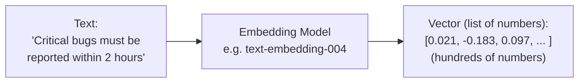

# Topic 4: What Does "Embedding" Mean?

> **Workshop:** Agentic AI for QA — Day [X]
> **Session:** Grounded QA Agents (Theory before Build)

---

## 1. The One-Line Definition

> An **embedding** is a way of converting a piece of text into a **list of numbers** that represents its **meaning** — so that a computer can measure how *similar in meaning* two pieces of text are, just by comparing numbers.

That's it. No magic — just a clever way to turn "meaning" into math.

---

## 2. Why Do We Even Need This?

Computers are naturally good at comparing **exact text**: `"qa-blue" == "qa-blue"` → yes, same. `"qa-blue" == "QA Blue environment"` → no, not an exact match, even though a human instantly understands these are related.

Traditional keyword search (like Ctrl+F) only finds *exact or near-exact* words. But when a user asks a question in their own words — e.g. *"Which environment runs the nightly regression suite?"* — the actual document might say *"qa-blue... the ONLY environment where the nightly automated regression suite runs"* — different wording, same meaning.

We need a way for the computer to search by **meaning**, not just by matching letters. That's exactly what embeddings make possible.

---

## 3. The Analogy: GPS Coordinates for Meaning

Imagine every sentence or paragraph gets assigned a **location on a map** — but instead of representing physical location, this map represents *meaning*.

- Sentences with **similar meaning** end up **close together** on this map.
- Sentences with **unrelated meaning** end up **far apart**.

| Text | "Location" on the Meaning Map (simplified) |
|---|---|
| "Critical bugs must be reported within 2 hours" | 📍 Near "bug severity," "SLA," "escalation" |
| "Report urgent defects immediately to QA Lead" | 📍 Very close to the above — same meaning, different words |
| "The nightly regression suite runs on qa-blue" | 📍 Near "test environment," "regression," "automation" |
| "What's the capital of France?" | 📍 Far away from all QA-related content |

An embedding is simply the **set of coordinates** for a piece of text on this "meaning map." In reality it's not a simple 2D map — it's a map with hundreds or thousands of dimensions — but the idea is identical: **closer = more similar in meaning.**

---

## 4. How Does the Embedding Model Actually Do This?

You don't need to know the deep math, but here's the simple version of what happens inside an embedding model (e.g. Google's `text-embedding-004`, which our workflow uses):

1. **It was trained on a massive amount of text**, learning patterns of which words/phrases tend to appear in similar contexts (e.g. "SLA," "escalation," and "severity" often appear near each other; "pizza" never appears near "regression suite").
2. When you give it a new piece of text, it runs that text through its trained neural network.
3. The network outputs a fixed-length **list of numbers** — e.g. 768 numbers — called a **vector**. This vector is the text's "coordinates" on the meaning map.
4. Text with similar meaning produces vectors that are **numerically close** to each other (this closeness is measured using simple math — most commonly something called *cosine similarity*, which you can think of as "how aligned are these two arrows pointing").

You don't need to interpret what any single number "means" individually — just like you don't interpret a single GPS coordinate digit on its own. What matters is the **relative distance** between two full vectors.

---

## 5. Where This Fits in Our RAG Pipeline

Recall from Topic 3 — embeddings are used in **two places**, and this is reflected in our n8n workflow having two separate embedding nodes:

| Step | What Gets Embedded | Node in Our Workflow |
|---|---|---|
| **Ingestion** (once) | Every chunk of the source document (QA Standards, API Spec, etc.) | `Embeddings Google Gemini (Ingestion)` |
| **Retrieval** (every question) | The user's incoming question | `Embeddings Google Gemini (Retrieval)` |

Then the vector store compares the question's vector against all the stored chunk vectors, and returns the **closest matches** — those become the "retrieved content" that grounds the agent's answer.

> **Important:** both the document chunks and the user's question must be embedded using the *same* embedding model — otherwise their "meaning maps" won't line up and comparisons become meaningless. This is why our workflow uses the identical `models/text-embedding-004` model for both ingestion and retrieval.

---

## 6. A Concrete Walkthrough Using Our Own Example

**User asks:** *"Which environment does our nightly regression run on?"*

1. This question is converted into a vector by the embedding model.
2. The vector store compares this vector against all stored chunk vectors from the QA Standards document.
3. The chunk containing: *"qa-blue: the ONLY environment where the nightly automated regression suite runs..."* has a vector that is numerically closest to the question's vector — even though the words don't match exactly ("nightly regression run" vs. "nightly automated regression suite runs").
4. That chunk gets retrieved and handed to the agent.
5. The agent answers: *"Per the Test Environments section: the regression suite runs on qa-blue only."*

This is only possible because embeddings capture **meaning**, not just exact keywords.

---

## 7. Keeping It Simple — What You Actually Need to Remember

You do **not** need to understand neural networks or the actual math to use this effectively. For this workshop, remember just these 4 points:

1. An embedding turns text into a list of numbers that represents its *meaning*.
2. Texts with similar meaning → numerically close vectors. Unrelated texts → far apart vectors.
3. This lets us **search by meaning** instead of exact keyword matching — which is essential because users never phrase questions exactly like the source document.
4. In our n8n workflow, this happens automatically inside the `Embeddings Google Gemini` nodes — you don't write this math yourself, you just plug in an embedding model and the Vector Store node handles the comparison.

---

## 8. Quick Recap — Tying All 4 Topics Together

| Topic | Core Idea |
|---|---|
| **1. Grounding** | Force the agent to use a real source instead of memory |
| **2. Why it matters** | Without it, agents hallucinate confidently and silently — risky for QA |
| **3. RAG** | The technique: Retrieve relevant chunks → Augment the prompt → Generate the answer |
| **4. Embeddings** | The mechanism that makes "retrieval by meaning" possible — text becomes comparable numbers |

> With all 4 concepts in place, you're now ready to open `10.1_knowledge_assistant_simple_vector_store.json` and `10.2_grounded_test_case_generator.json` and see exactly how each node maps to what we just learned.
